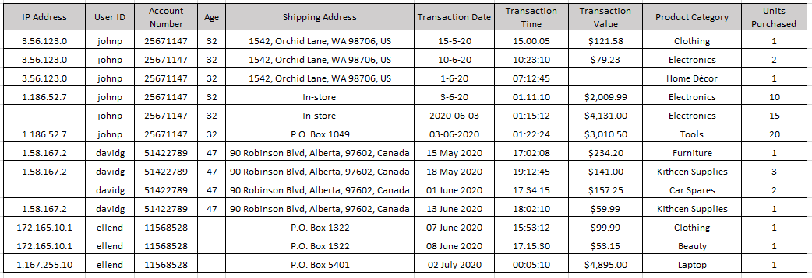
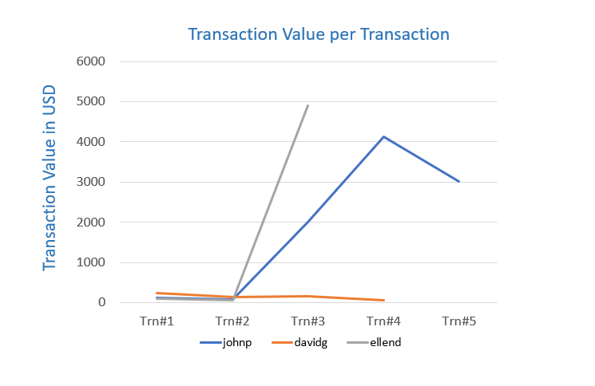

# data-analysis-for-detecting-for-credit-card-fraud
Companies today are employing analytical techniques for the early detection of credit card frauds, a key factor in mitigating fraud damage. The most common type of credit card fraud does not involve the physical stealing of the card, but that of credit card credentials, which are then used for online purchases.

Imagine that you have been hired as a Data Analyst to work in the Credit Card Division of a bank. And your first assignment is to join your team in using data analysis for the early detection and mitigation of credit card fraud.  

In order to prescribe a way forward, that is, suggest what should be done in order for fraud to get detected early on, you need to understand what a fraudulent transaction looks like. And for that you need to start by looking at historical data. 

**Here is a sample data set that captures the credit card transaction details for a few users.**



Descriptive techniques of analysis, that is, techniques that help you gain an understanding of what happened, include the identification of patterns and anomalies in data. Anomalies signify a variation in a pattern that seems uncharacteristic, or, out of the ordinary. Anomalies may occur for perfectly valid and genuine reasons, but they do warrant an evaluation because they can be a sign of fraudulent activity.  

**Past studies have suggested that some of the common events that you may need to watch out for include:** 

* A change in frequency of orders placed, for example, a customer who typically places a couple of orders a month, suddenly makes numerous transactions within a short span of time, sometimes within minutes of the previous order.

* Orders that are significantly higher than a user’s average transaction.

* Bulk orders of the same item with slight variations such as color or size—especially if this is atypical of the user’s transaction history.

* A sudden change in delivery preference, for example, a change from home or office delivery address to in-store, warehouse, or PO Box delivery.

* A mismatched IP Address, or an IP Address that is not from the general location or area of the billing address.

**Before you can analyze the data for patterns and anomalies, you need to:**

* **Identify and gather all data points that can be of relevance to your use case.** For example, the card holder’s details, transaction details, delivery details, location, and network are some of the data points that could be explored. 

* **Clean the data.** You need to identify and fix issues in the data that can lead to false or incomplete findings, such as missing data values and incorrect data. You may also need to standardize data formats in some cases, for example, the date fields. 

Finally, when you arrive at the findings, you will create appropriate visualizations that communicate your findings to your audience. The graph below samples one such visualization that you would use to capture a trend hidden in the sample data set shared earlier on in the case study.



## Case Study

1. Based on the data table, identify which transaction stands out as the highest value in the dataset. (1 point)
   ```
   Ellend - $4,895.00 (Laptop)
   ```
> **Grading Feedback**: Ellend made a high value transaction.
   
2. Based on the overall trend in the chart, which user's transactions may require closer monitoring for potential fraud (1 point)
   ```
   Johnp and Ellend
   ```
> **Grading Feedback**: Both Johnp and Ellend require closer monitoring. Johnp shows unusually high transactions in Trn#3 and Trn#4 compared to earlier activity, while Ellend’s single large spike at Trn#3 is highly irregular. Both patterns deviate significantly from their typical behavior.

3. Identify 3 errors/issues that could impact the accuracy of your findings (3 points)
   ```
   Different date formats (e.g., 15-5-20 vs 01 June 2020)
   Missing transaction values
   Missing IP address
   ```
> Grading Feedback:
> Inconsistent date formats can cause parsing errors and lead to incorrect analysis or reporting.
> Missing values affect data completeness and can distort calculations, trends, and insights.
> IP addresses are critical for tracking, auditing, and identifying suspicious activity; missing values reduce data reliability.
   
4. Which type of analysis are you performing in the case study when examining historical credit card data to understand the characteristics of fraudulent transaction? (1 point)
   ```
   Descriptive analysis
   ```
> **Grading Feedback**: This analysis involves describing past data to understand its characteristics.

5. What is a sudden switch from a customer's regular residential delivery address to a PO Box most likely regarded as? (1 point)
   ```
   An unusual pattern
   ```
> **Grading Feedback**: This is typically viewed as an anomaly.

6. Examine the transaction for the user johnp and explain why their purchasing behaviour could be considered suspicious. Support your conclusion with at least two distinct data points from the table. (2 points)
   ```
   * Transaction Value: johnp's transaction values suddenly increased from $121.58 and $79.23 to $2,009.99, $4,131.00 and $3,010.50.
   * Shipping Address: His shipping preference suddenly changed from his home address to in-store collection and a P.O. Box.
   * IP Address: His IP address changed from 3.56.123.0 to 1.186.52.7.
   ```
> **Grading Feedback**: You support your suspicion with several distinct changes, including much higher transaction amounts, changed shipping preferences, and a different IP address. This directly addresses the question with specific data points.

7. Which of the following sets of data points are required for analysis and detection of credit card fraud? (1 point)
    ```
    Cardholder details (e.g., Customer ID, Account status)
    Transaction amount
    Transaction timestamp
    Delivery address
    IP address
    ```
> **Grading Feedback**: These data points are essential for fraud detection as they help analyze transaction behavior, identify anomalies, and assess risk based on location, timing, and account activity.
